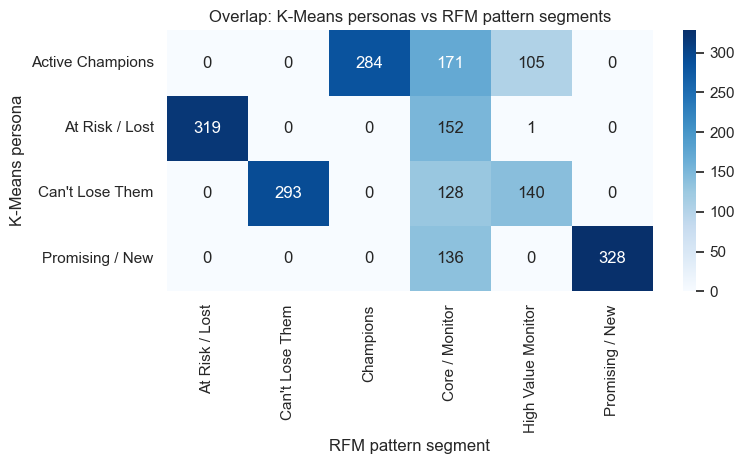

# Customer segmentation, churn and lifetime value

How do customer groups, churn predictions and spending forecasts support different marketing decisions? Three studies compare those approaches and examine where the data limit their usefulness.

| Study | Question | Files |
| :--- | :--- | :--- |
| Segmentation | Do RFM rules and clustering identify the same customers? | [Notebook](01-segmentation/analysis.ipynb) · [Slides](01-segmentation/slides.pdf) |
| Churn | Which customers are likely to leave, and how does the contact budget affect the choice? | [Notebook](02-churn/analysis.ipynb) · [Slides](02-churn/slides.pdf) |
| Customer value | How useful are lifetime-value models when almost everyone buys once? | [Notebook](03-customer-value/analysis.ipynb) · [Slides](03-customer-value/slides.pdf) |

## 1. Comparing customer segments

The first study audits 2,240 customer records and prepares a 2,057-customer analysis set after cleaning. It compares additive and pattern-based RFM rules with K-means on recency, purchase frequency and log-transformed spending.



The overlap table shows how a simple business rule and a distance-based partition group the same customers. Silhouette checks and alternative cleaning choices help assess whether the grouping reflects stable structure or preprocessing decisions. Segment-specific communication proposals are hypotheses for a campaign, not measured campaign results.

## 2. Trading precision for recall in churn prediction

Logistic regression, random forest and XGBoost are compared with stratified splits and training-fold preprocessing. Removing 556 duplicate profiles before splitting prevents identical records from appearing on both sides of the evaluation.

| XGBoost configuration | Recall | F1 | ROC AUC |
| :--- | ---: | ---: | ---: |
| Baseline used in the contact-policy analysis | 0.929 | 0.876 | 0.985 |
| Tuned with randomized search | 0.911 | 0.916 | 0.990 |

On the 1,015-customer test set, including 168 churners, tuning improves precision and F1 but lowers recall. The notebook uses the baseline for its stated recall priority. This illustrates why the metric used to select a model must match the decision it supports; a contact budget also limits how many customers can be targeted.


## 3. Forecasting value when repeat purchases are rare

The Olist study joins nine tables into 96,211 delivered transactions for 93,104 customers. It compares BG/NBD plus Gamma-Gamma with random forest and two XGBoost objectives over a 90-day holdout.

Only **81 of 15,027 test customers** have non-zero holdout spending. Predicting zero is therefore an essential baseline:

| Model | MAE, R$ | RMSE, R$ |
| :--- | ---: | ---: |
| Predict zero | **0.72** | 13.72 |
| Random forest | 0.75 | 13.72 |
| XGBoost, squared error | 0.75 | 13.72 |
| XGBoost, Tweedie | 1.41 | **13.70** |
| BG/NBD + Gamma-Gamma | 2.56 | 13.94 |

The zero predictor has the lowest MAE. Tweedie's total forecast is close to observed holdout GMV, about R$10.6k versus R$10.9k, but its individual error improvement is small. Aggregate agreement does not imply accurate customer-level forecasts. About 91.2% of the full-base BTYD forecast comes from one-time buyers, making that assumption particularly consequential.

## Contribution

**Matteo Pietro Di Pilato** · Artificial Intelligence for Communication and Marketing, BSc in Artificial Intelligence. These are my three individual course studies, including data audits, modelling, comparisons and presentations.

The repository began as a fork of the [course setup repository](https://github.com/sbesby/ai4cm). Its environment checks, introductory guides and `AGENTS.md` are inherited course material; the project directories are my additions.

## Limits and next steps

The churn test set informed model comparisons and the decision to retain the baseline; an independent temporal evaluation is needed before deployment. Campaign economics are hypothetical, and no causal uplift was measured. The lifetime-value comparison is dominated by customers with no holdout spending.

The next steps are a temporal churn test, an out-of-period value forecast and a controlled campaign evaluation before using the proposed contact policies.

## Run

Obtain the inputs listed in [data/README.md](data/README.md), then:

```bash
git clone https://github.com/pdmdp/ai4cm.git
cd ai4cm
mamba env create -f environment.yml
mamba run -n ai4cm-env python scripts/check_data.py
mamba run -n ai4cm-env jupyter lab
```

Open an `analysis.ipynb` with the `ai4cm-env` kernel and run its cells in order. The notebooks locate inputs relative to the repository root; part 3 uses one training worker to limit memory use. [Reproduction results](results/reproduction-check.json) and [implementation notes](PORTFOLIO_UPDATE.md) describe the executed checks and environment scope.
