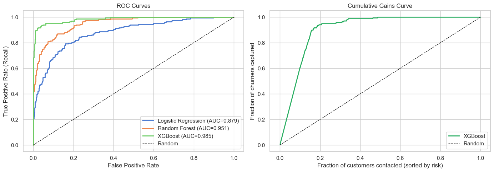

# Customer segmentation, churn and lifetime value

Three studies of customer behavior, developed for Artificial Intelligence for Communication and Marketing. The work moves from descriptive segmentation to churn prediction and then to forecasting customer value on sparse transaction histories.

| Study | Main question | Files |
| :--- | :--- | :--- |
| Segmentation | Do RFM rules and clustering identify the same customers? | [Notebook](01-segmentation/analysis.ipynb) · [Slides](01-segmentation/slides.pdf) |
| Churn | Which customers are most likely to leave, and how does the contact budget change the choice? | [Notebook](02-churn/analysis.ipynb) · [Slides](02-churn/slides.pdf) |
| Customer value | How useful are lifetime-value models when almost everyone buys once? | [Notebook](03-customer-value/analysis.ipynb) · [Slides](03-customer-value/slides.pdf) |

## 1. RFM and behavioral clustering

The first study audits 2,240 customer records, removes duplicate profiles and prepares a 2,057-customer analysis set. It compares additive and pattern-based RFM segments with K-means on recency, purchase frequency and log-transformed spending. Silhouette checks and alternative cleaning choices help distinguish stable structure from artifacts of the preprocessing.


The practical output is a set of segment-specific communication proposals. These are recommendations derived from observed behavior, not measured campaign effects.

## 2. Churn prediction

Logistic regression, random forest and XGBoost are compared using stratified splits and training-fold preprocessing. Removing 556 duplicate profiles before splitting prevents identical customer records from appearing on both sides of the evaluation.

| XGBoost configuration | Recall | F1 | ROC AUC |
| :--- | ---: | ---: | ---: |
| Baseline used in the contact-policy analysis | 0.929 | 0.876 | 0.985 |
| Tuned with randomized search | 0.911 | 0.916 | 0.990 |

The test set contains 1,015 customers, including 168 churners. Tuning improves precision and F1 while lowering recall. The notebook retains the baseline for its stated recall priority. Because model comparisons and that decision use the same test set, an independent temporal evaluation would be needed before deployment.



## 3. Customer value on Olist

The final study audits nine related tables and builds 96,211 delivered transactions for 93,104 customers. It compares BG/NBD plus Gamma-Gamma with random forest and two XGBoost objectives over a 90-day holdout.

Only **81 of 15,027 test customers** have non-zero holdout spending. This makes a zero predictor a necessary baseline:

| Model | MAE, R$ | RMSE, R$ |
| :--- | ---: | ---: |
| Predict zero | **0.72** | 13.72 |
| Random forest | 0.75 | 13.72 |
| XGBoost, squared error | 0.75 | 13.72 |
| XGBoost, Tweedie | 1.41 | **13.70** |
| BG/NBD + Gamma-Gamma | 2.56 | 13.94 |

Tweedie's aggregate forecast is close to the observed holdout GMV (about R$10.6k versus R$10.9k), but the individual error improvement is small. The full-base BTYD forecast depends heavily on one-time buyers: about 91.2% of its forecast value comes from that group. The notebook therefore separates forecasting assumptions, customer ranking and hypothetical campaign economics. No incremental campaign revenue or causal uplift was measured.

## Run

Obtain the inputs using [data/README.md](data/README.md), then:

```bash
git clone https://github.com/pdmdp/ai4cm.git
cd ai4cm
mamba env create -f environment.yml
mamba run -n ai4cm-env python scripts/check_data.py
mamba run -n ai4cm-env jupyter lab
```

Open one of the three `analysis.ipynb` files with the `ai4cm-env` kernel and run cells in order. The notebooks locate data relative to the repository root. Part 3 uses one training worker to limit memory use. The environment file describes the local analysis environment; a fresh environment solve has not been verified on every platform.

All three packaged notebooks were executed from start to finish on 15 November 2026 using the recorded local inputs. The checks reproduced the segmentation sample size, churn metrics and customer-value comparison shown here. [Execution results](results/reproduction-check.json) record the observed values.

The notebooks retain the final coursework outputs. README figures are extracted from those outputs. The November 2026 packaging update fixes paths, records input checksums and qualifies unsupported generalization claims. Numerical tables above describe the recorded runs.

## Author and course material

**Matteo Pietro Di Pilato** · BSc in Artificial Intelligence.

The three project notebooks and their presentations are the final individual course submission. The repository also retains the earlier course environment checks in `setup/` and introductory notes in `quick-guide/`.
